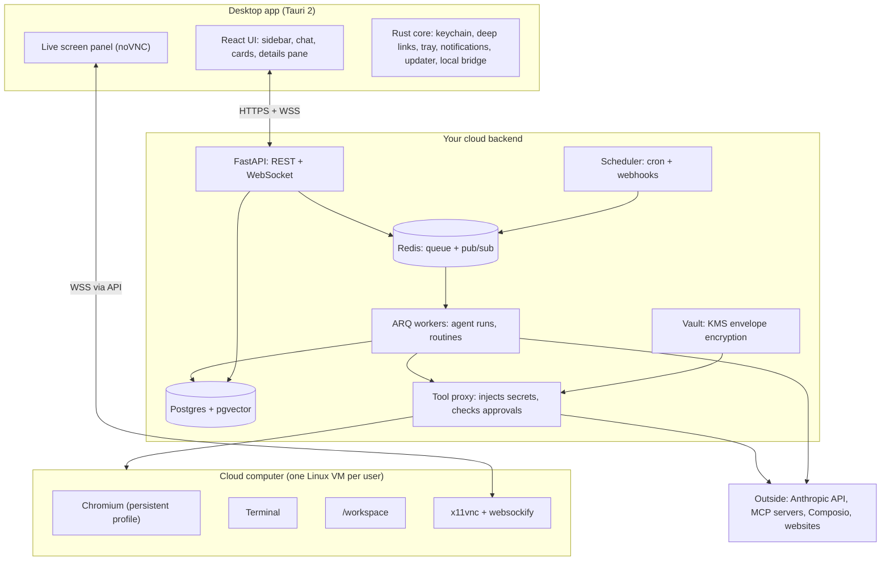

# 02. Architecture

## Three layers



## What runs where

| Layer | Runs | Why |
|---|---|---|
| Desktop app | On the user's laptop | UI, notifications, secure token storage. Holds no business logic. |
| Backend | Your servers (AWS, Fly.io, Railway) | Agent loop, scheduling, data, secrets. Works when the laptop is off. |
| Cloud computer | E2B sandbox (prod) or Docker (dev) | Where Bots browse, run commands and keep files. |

## The life of one message

1. User types in the composer and presses Enter.
2. Desktop calls `POST /chats/{id}/messages`. The API saves the message, creates a `runs` row (status `queued`) and pushes a job to Redis.
3. The API returns `{run_id}` right away. The desktop is already subscribed to the chat on the WebSocket.
4. A worker picks the job. It loads the Bot (instructions, memory, skills, tools) and the recent chat history.
5. The agent loop calls Claude with streaming on. Each token is published to Redis channel `chat:{id}`; the API forwards it over the WebSocket as `message.delta`.
6. Claude asks for a tool. The worker writes a `tool_calls` row, then sends it through the tool proxy.
7. The proxy checks the risk level. Risky and not approved? It creates an `approvals` row, sets the run to `waiting_approval`, publishes `approval.created`, and stops the loop.
8. Safe or approved? The proxy swaps in Vault secrets, runs the tool (on the cloud computer, a connector, or the web) and returns the result.
9. The loop feeds the result back to Claude and repeats until Claude ends its turn, or until the step or token limit.
10. The worker saves the final message, updates memory if needed, sets the run to `completed` and publishes `run.completed`.
11. If the desktop window is hidden, the Rust core shows a notification.

## Approval resume

1. User clicks Approve (optionally edits the drafted action).
2. Desktop calls `POST /approvals/{id}/approve` with any edits.
3. API marks the approval `approved`, re-queues the run with `resume_from_tool_call_id`.
4. Worker runs exactly that tool call with exactly the approved arguments, then continues the loop.

## Repo layout

```
crew/
  apps/
    desktop/
      src/                      React app
        app/                    routes and layout
        features/
          auth/ bots/ chat/ approvals/ screen/ skills/ routines/
          connectors/ vault/ library/ groups/ settings/
        components/ui/          shadcn components
        lib/api/                generated client + fetch wrapper
        lib/ws.ts               WebSocket client with reconnect
        lib/tauri.ts            typed wrappers around invoke()
      src-tauri/
        src/
          main.rs  lib.rs
          auth.rs               deep link + keychain
          tray.rs  notify.rs  updater.rs
          bridge.rs             local bridge (phase 11, optional)
        capabilities/default.json
        tauri.conf.json
  services/
    pyproject.toml
    api/                        FastAPI app (routers only)
      main.py  deps.py  ws.py
      routers/ auth.py bots.py chats.py runs.py approvals.py skills.py
               routines.py connectors.py vault.py library.py computer.py webhooks.py
    worker/
      main.py                   ARQ WorkerSettings, job functions
      scheduler.py              cron routines
    shared/crew/
      config.py  db.py  models/  schemas/
      agent/loop.py  agent/prompts.py  agent/router.py (Primary Bot)
      tools/registry.py  tools/web.py  tools/files.py  tools/browser.py
      tools/terminal.py  tools/connectors.py  tools/memory.py
      computer/provider.py  computer/docker_provider.py  computer/e2b_provider.py
      approvals/policy.py
      vault/crypto.py  vault/inject.py
      memory/store.py
      events.py                 Redis pub/sub helpers
      budget.py
    alembic/
    tests/
  infra/
    docker-compose.yml
    computer/Dockerfile  computer/start.sh
  docs/
```
